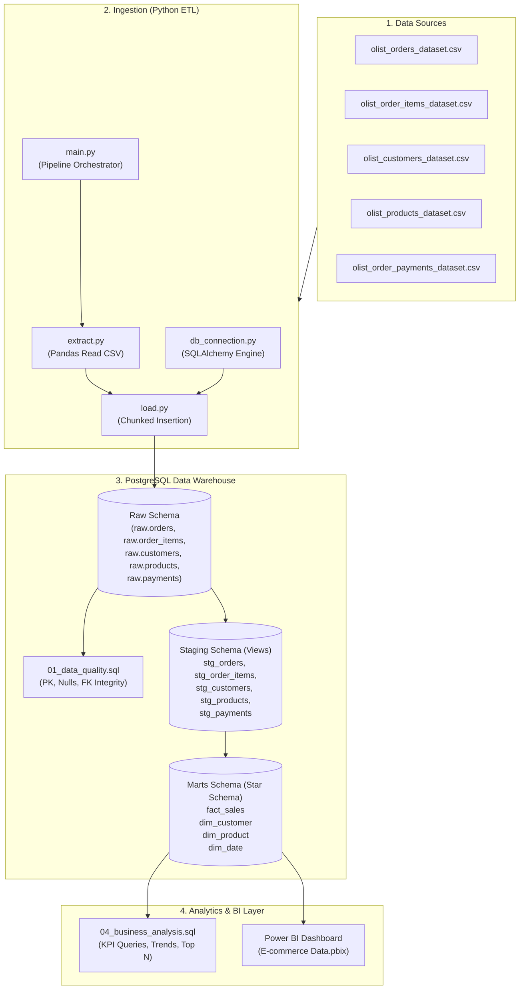
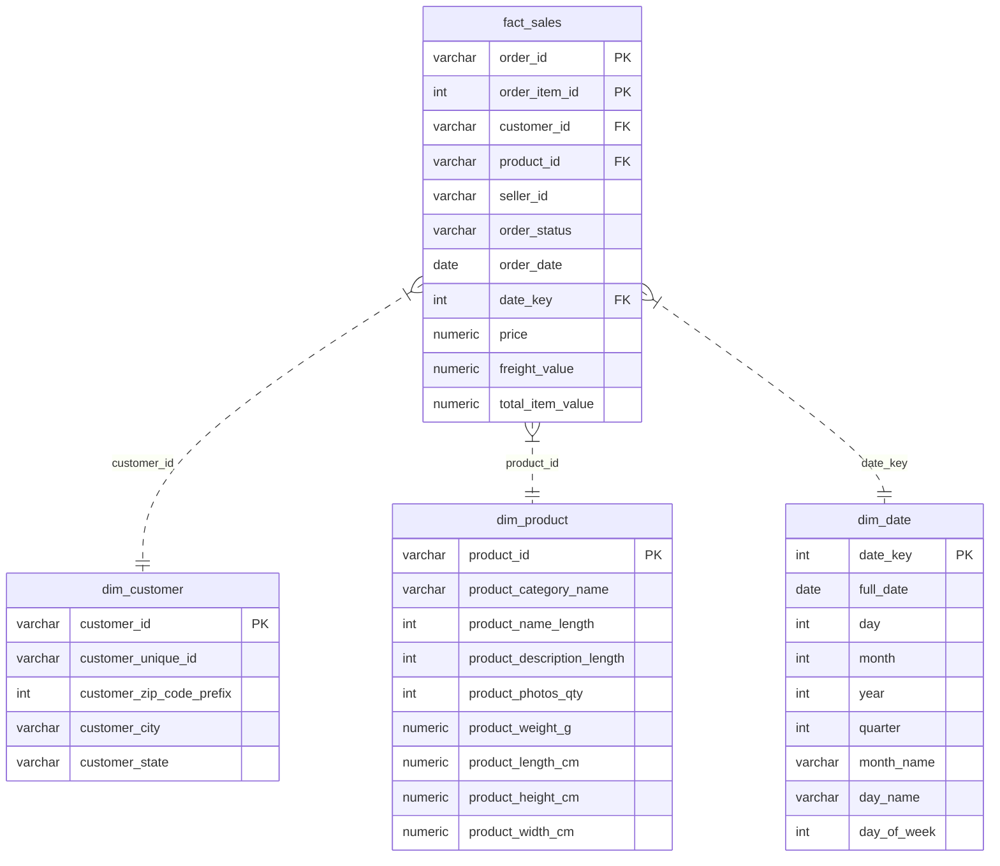

# 🛒 E-Commerce End-to-End Data Pipeline & Analytics

[](https://www.python.org/)
[](https://www.postgresql.org/)
[](https://pandas.pydata.org/)
[](https://www.sqlalchemy.org/)
[](https://powerbi.microsoft.com/)

Dự án xây dựng luồng dữ liệu tự động (**End-to-End Data Pipeline**) từ dữ liệu thô (Raw CSV) của sàn thương mại điện tử **Olist (Brazil)**, nạp vào **PostgreSQL Data Warehouse**, chuẩn hóa theo mô hình **Star Schema (Data Marts)**, thực hiện phân tích số liệu kinh doanh qua **SQL** và trực quan hóa Dashboard trên **Power BI**.

---

## 📌 Mục Lục
1. [Tổng Quan Dự Án](#-tổng-quan-dự-án)
2. [Kiến Trúc Pipeline](#-kiến-trúc-pipeline)
3. [Bộ Dữ Liệu (Dataset)](#-bộ-dữ-liệu-dataset)
4. [Mô Hình Dữ Liệu (Star Schema)](#-mô-hình-dữ-liệu-star-schema)
5. [Cấu Trúc Thư Mục](#-cấu-trúc-thư-mục)
6. [Công Nghệ Sử Dụng](#-công-nghệ-sử-dụng)
7. [Các Câu Hỏi Phân Tích Kinh Doanh](#-các-câu-hỏi-phân-tích-kinh-doanh)
8. [Hướng Dẫn Cài Đặt & Chạy Dự Án](#-hướng-dẫn-cài-đặt--chạy-dự-án)
9. [Báo Cáo & Trực Quan Hóa (Power BI)](#-báo-cáo--trực-quan-hóa-power-bi)

---

## 📖 Tổng Quan Dự Án

Thương mại điện tử có khối lượng giao dịch lớn, dữ liệu phân tán ở nhiều bảng khác nhau và thường chứa dữ liệu thiếu, sai định dạng hoặc không nhất quán. Dự án này giải quyết bài toán:
- **Tự động hóa Ingestion**: Đọc dữ liệu lớn từ CSV bằng Python & nạp vào PostgreSQL với cơ chế chia nhỏ batch (`chunksize=5000`) nhằm tối ưu bộ nhớ.
- **Data Cleansing & Staging**: Xử lý khoảng trắng thừa (`TRIM`), chuẩn hóa định dạng chữ (`LOWER`/`UPPER`), ép kiểu dữ liệu chuẩn (`TIMESTAMP`, `NUMERIC`, `INTEGER`), và gán giá trị mặc định cho dữ liệu khuyết thiếu (`COALESCE`).
- **Data Modeling (Data Marts)**: Thiết kế mô hình chiều chuẩn (**Star Schema**) phân tách rõ ràng giữa bảng sự kiện (**Fact**) và các bảng chiều (**Dimension**), hỗ trợ truy vấn báo cáo tốc độ cao.
- **Business Intelligence**: Truy vấn SQL chuyên sâu trả lời các câu hỏi về doanh thu, khách hàng, sản phẩm, vận chuyển và phương thức thanh toán. Kết nối dữ liệu vào Power BI để xây dựng hệ thống báo cáo tương tác trực quan.

---

## 🏗 Kiến Trúc Pipeline

Luồng luân chuyển dữ liệu tuân thủ mô hình **ELT (Extract - Load - Transform)**:



---

## 📂 Bộ Dữ Liệu (Dataset)

Dự án sử dụng bộ dữ liệu công khai **Brazilian E-Commerce Public Dataset by Olist** gồm hơn **100.000 đơn hàng** thực tế từ 2016 đến 2018 tại Brazil:

| Tên File | Số Dòng | Mô Tả |
| :--- | :--- | :--- |
| `olist_orders_dataset.csv` | ~99.4K | Thông tin đơn hàng, trạng thái (`delivered`, `shipped`, `canceled`...) và các mốc thời gian đặt/giao. |
| `olist_order_items_dataset.csv` | ~112.6K | Chi tiết từng sản phẩm trong mỗi đơn hàng, giá bán (`price`) và phí vận chuyển (`freight_value`). |
| `olist_customers_dataset.csv` | ~99.4K | Mã khách hàng (`customer_id`, `customer_unique_id`), thành phố, bang và zip code. |
| `olist_products_dataset.csv` | ~32.9K | Danh mục sản phẩm, số lượng ảnh, kích thước và khối lượng sản phẩm. |
| `olist_order_payments_dataset.csv` | ~103.8K | Phương thức thanh toán (credit card, boleto, voucher, debit card), số lần trả góp và số tiền thanh toán. |
| `product_category_name_translation.csv` | 71 | Bảng dịch danh mục sản phẩm từ tiếng Bồ Đào Nha sang tiếng Anh. |

---

## 🏛 Mô Hình Dữ Liệu (Star Schema)

Trong schema `marts`, dữ liệu được thiết kế theo mô hình **Star Schema** tối ưu hóa cho phân tích OLAP:



### Các lớp Schema trong CSDL:
1. **`raw` (Raw Data)**: Bảng lưu trữ nguyên bản từ CSV, không can thiệp logic để bảo toàn tính toàn vẹn nguồn.
2. **`staging` (Data Cleansing Views)**:
   - Làm sạch khoảng trắng (`TRIM`), chuẩn hóa chữ hoa/chữ thường.
   - Ép kiểu dữ liệu thời gian (`TIMESTAMP`), số tiền (`NUMERIC(12,2)`).
   - Xử lý các giá trị rỗng/chuỗi trống thành `NULL` bằng `NULLIF`.
   - Lọc bỏ các dòng lỗi khóa chính `order_id IS NOT NULL`.
3. **`marts` (Dimensional Model)**:
   - `dim_customer`: Thông tin vị trí, định danh khách hàng.
   - `dim_product`: Thông tin vật lý và phân loại ngành hàng.
   - `dim_date`: Bảng thời gian được sinh tự động bằng hàm `GENERATE_SERIES` từ ngày đơn hàng đầu tiên đến ngày đơn hàng cuối cùng.
   - `fact_sales`: Bảng sự kiện chứa các chỉ số đo lường (Measures: `price`, `freight_value`, `total_item_value`) liên kết với các bảng chiều.

---

## 📁 Cấu Trúc Thư Mục

```text
E-commerce Data Pipeline/
│
├── data/
│   └── raw/                                # Thư mục chứa các file dữ liệu CSV gốc
│       ├── olist_customers_dataset.csv
│       ├── olist_order_items_dataset.csv
│       ├── olist_order_payments_dataset.csv
│       ├── olist_orders_dataset.csv
│       ├── olist_products_dataset.csv
│       └── product_category_name_translation.csv
│
├── scripts/                                # Mã nguồn Python xử lý luồng dữ liệu
│   ├── db_connection.py                    # Khởi tạo kết nối SQLAlchemy tới PostgreSQL
│   ├── extract.py                          # Đọc dữ liệu từ CSV vào Pandas DataFrame
│   ├── load.py                             # Nạp dữ liệu vào PostgreSQL schema `raw` (batch chunked)
│   └── main.py                             # Điều phối thực thi toàn bộ pipeline ETL
│
├── sql/                                    # Kịch bản SQL chuyển đổi & phân tích
│   ├── 01_data_quality.sql                 # Kiểm tra chất lượng dữ liệu (Nulls, PK, FK, Dupes)
│   ├── 02_staging.sql                      # Tạo Views làm sạch và chuẩn hóa dữ liệu
│   ├── 03_data_marts.sql                   # Khởi tạo Star Schema (dim_*, fact_*)
│   └── 04_business_analysis.sql            # Các truy vấn phân tích nghiệp vụ & chỉ số kinh doanh
│
├── .env.example                            # Mẫu cấu hình thông tin kết nối CSDL
├── .gitignore                              # Danh sách các tệp/thư mục không đưa lên Git
├── E-commerce Data.pbix                    # Dashboard báo cáo tương tác trên Power BI
├── requirements.txt                        # Danh sách thư viện Python cần thiết
└── README.md                               # Tài liệu hướng dẫn dự án
```

---

## 🛠 Công Nghệ Sử Dụng

- **Ngôn ngữ**: Python 3.10+
- **Thư viện Python**:
  - `pandas`: Đọc, kiểm tra cấu trúc và xử lý dữ liệu dạng bảng.
  - `SQLAlchemy`: ORM & Connection engine quản lý kết nối cơ sở dữ liệu.
  - `psycopg2-binary`: Driver giao tiếp trực tiếp với PostgreSQL.
  - `python-dotenv`: Quản trị biến môi trường bảo mật.
- **Hệ quản trị CSDL**: PostgreSQL (Hỗ trợ Schemas, Views, Window Functions, Dimensional Modeling).
- **Business Intelligence**: Power BI Desktop (Trực quan hóa biểu đồ, xây dựng Data Model, DAX Measures).

---

## 📊 Các Câu Hỏi Phân Tích Kinh Doanh

File [`sql/04_business_analysis.sql`](file:///d:/DATA%20ANALYST/project/E-commerce%20Data%20Pipeline/sql/04_business_analysis.sql) giải quyết các bài toán phân tích cốt lõi:

1. **Tổng quan doanh thu & quy mô đơn hàng**:
   - Tổng số đơn hàng thành công, tổng sản phẩm bán ra.
   - Tổng doanh thu thuần (Net Sales), tổng phí vận chuyển (Freight Value) và tổng giá trị thanh toán (GMV).
2. **Xu hướng doanh thu theo thời gian**:
   - Doanh thu và số lượng đơn hàng theo từng tháng/năm, xác định chu kỳ tăng trưởng và các tháng cao điểm bán hàng.
3. **Top 10 sản phẩm & ngành hàng bán chạy nhất**:
   - Những mặt hàng đóng góp tỷ trọng doanh thu cao nhất cho sàn.
4. **Top 10 khách hàng chi tiêu nhiều nhất (VIP Customers)**:
   - Nhận diện nhóm khách hàng có giá trị vòng đời cao và khu vực sinh sống của họ.
5. **Tỷ lệ hoàn thành đơn hàng (Order Fulfillment Rate)**:
   - Tỷ lệ phần trăm giữa đơn thành công (`delivered`), đơn hủy (`canceled`), đơn đang giao (`shipped`),...
6. **Thời gian giao hàng trung bình (Average Delivery Lead Time)**:
   - Thời gian trung bình từ lúc đặt đơn (`order_purchase_timestamp`) đến khi khách nhận hàng (`order_delivered_customer_date`).
7. **Phân tích hành vi thanh toán**:
   - Tỷ trọng giao dịch và giá trị thanh toán theo từng hình thức (Thẻ tín dụng, Boleto, Voucher, Thẻ ghi nợ).

---

## 🚀 Hướng Dẫn Cài Đặt & Chạy Dự Án

### 1. Yêu cầu tiên quyết
- Đã cài đặt **Python 3.10+**
- Đã cài đặt **PostgreSQL** và tạo một Database rỗng (ví dụ: `ecommerce_dw`)
- Đã cài đặt **Power BI Desktop** (nếu muốn xem báo cáo `.pbix`)

### 2. Thiết lập môi trường ảo & cài đặt thư viện
Mở Terminal hoặc PowerShell tại thư mục gốc dự án:

```bash
# Tạo môi trường ảo (nếu chưa có)
python -m venv venv

# Kích hoạt môi trường ảo
# Trên Windows PowerShell:
.\venv\Scripts\Activate.ps1
# Hoặc trên Windows Command Prompt:
.\venv\Scripts\activate.bat

# Cài đặt các thư viện cần thiết
pip install -r requirements.txt
```

### 3. Cấu hình biến môi trường
Tạo file `.env` từ file mẫu `.env.example`:

```bash
cp .env.example .env
```

Mở file `.env` và điền thông tin kết nối PostgreSQL của bạn:
```ini
DB_HOST=localhost
DB_PORT=5432
DB_NAME=ecommerce_dw
DB_USER=postgres
DB_PASSWORD=mat_khau_cua_ban
```

Kiểm tra kết nối tới cơ sở dữ liệu:
```bash
python scripts/db_connection.py
```
*Kết quả xuất hiện `PostgreSQL connected successfully!` nghĩa là kết nối đã sẵn sàng.*

### 4. Thực thi luồng dữ liệu (ETL Pipeline)
Chạy script chính để trích xuất dữ liệu từ các file CSV và nạp vào schema `raw` trong PostgreSQL:

```bash
python scripts/main.py
```

### 5. Thực thi các kịch bản SQL chuyển đổi dữ liệu
Sử dụng công cụ quản trị CSDL (**pgAdmin 4**, **DBeaver** hoặc `psql`) để thực thi các file SQL theo thứ tự:

1. **`sql/01_data_quality.sql`**: Kiểm tra tính toàn vẹn dữ liệu (Nulls, Duplicates, Khóa ngoại).
2. **`sql/02_staging.sql`**: Tạo schema `staging` và các Views làm sạch dữ liệu.
3. **`sql/03_data_marts.sql`**: Tạo schema `marts`, các bảng Dimension và Fact (`fact_sales`).
4. **`sql/04_business_analysis.sql`**: Chạy các truy vấn phân tích nghiệp vụ và trích xuất chỉ số kinh doanh.

---

## 📈 Báo Cáo & Trực Quan Hóa (Power BI)

File [`E-commerce Data.pbix`](file:///d:/DATA%20ANALYST/project/E-commerce%20Data%20Pipeline/E-commerce%20Data.pbix) được kết nối trực tiếp tới mô hình dữ liệu Star Schema (`marts`) trong PostgreSQL:
- **Executive Summary Dashboard**: Thẻ KPI tổng quan (Doanh thu, Đơn hàng, AOV, Tỷ lệ giao hàng thành công).
- **Sales Performance**: Biểu đồ đường thể hiện xu hướng doanh thu qua từng tháng, biểu đồ cột phân tích doanh số theo danh mục sản phẩm.
- **Customer & Geography Insights**: Bản đồ nhiệt phân bổ đơn hàng và khách hàng theo từng tiểu bang tại Brazil (`customer_state`).

---

## 👤 Tác Giả & Liên Hệ

- **Họ và tên**: Đặng Đức Tĩnh
- **Email**: [dangductinh1103@gmail.com](mailto:dangductinh1103@gmail.com)
- **Lĩnh vực**: Data Analyst / Data Engineer / Business Intelligence

---
⭐ *Nếu bạn thấy dự án này hữu ích, hãy để lại 1 Star trên GitHub repository nhé!*
